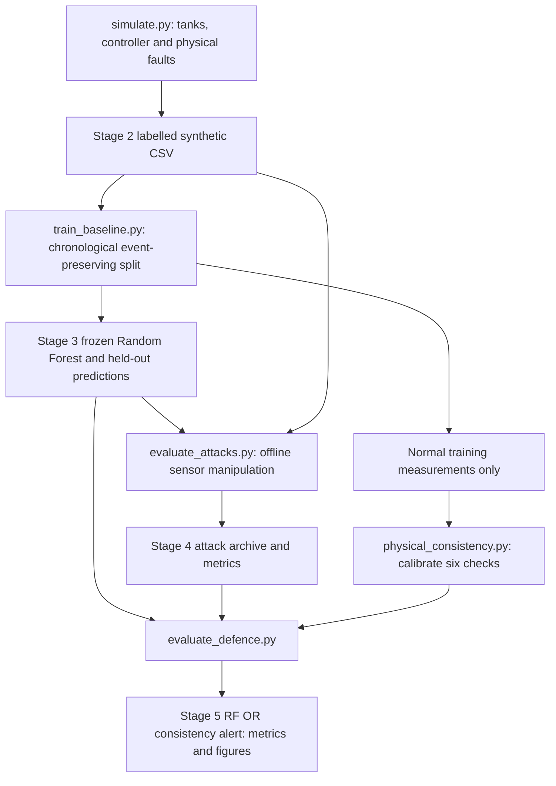
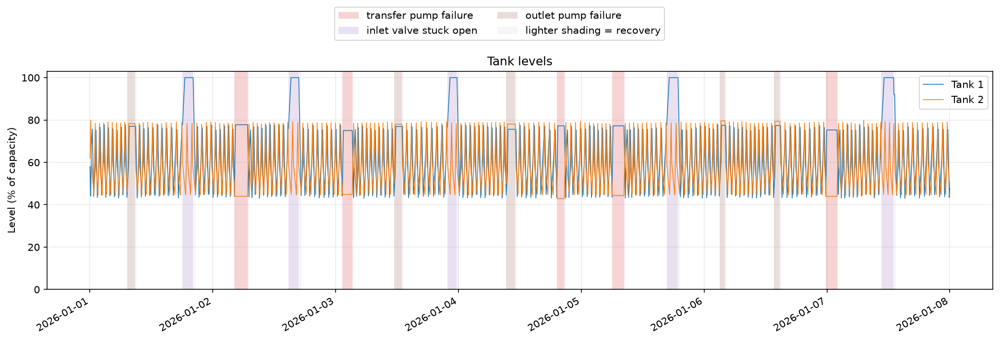
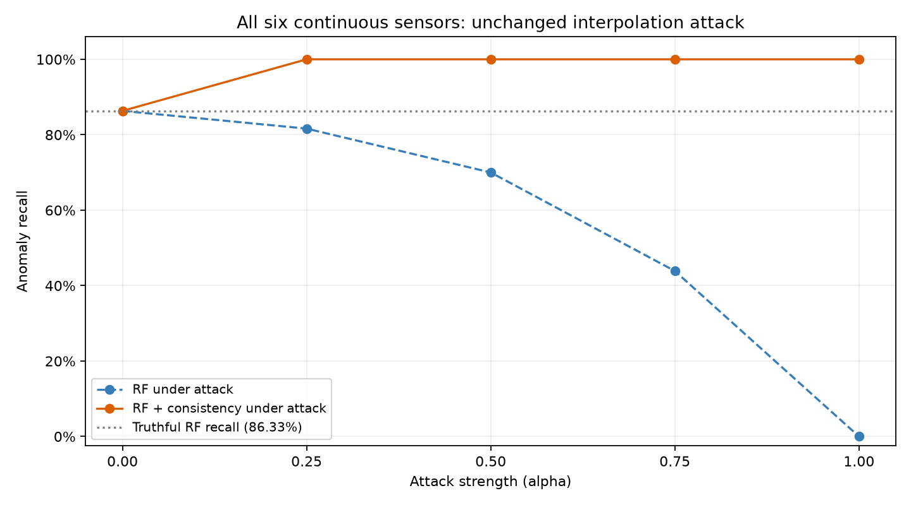
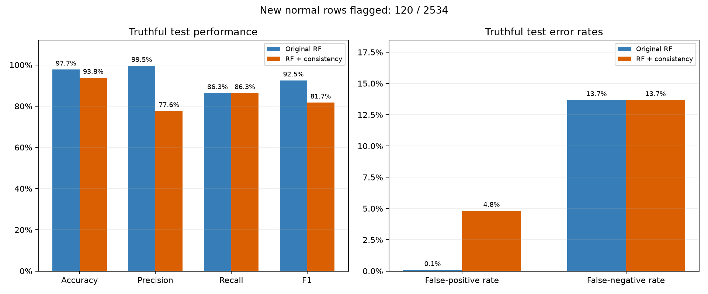

# ICS Anomaly Detection: Adversarial Sensor Manipulation in Water Treatment Systems

## 1. Project Overview

A reproducible Python study of sensor manipulation against machine-learning anomaly detection in a **simulated** industrial water treatment process. A supervised Random Forest detects physical equipment faults; offline experiments then alter the reported sensor values while leaving the physical process unchanged. A physical-consistency layer tests whether relationships between measurements can recover missed detections.

## 2. Research Objectives

- Model normal operation, actuator faults and recovery without resetting process state.
- Establish a chronological, event-preserving anomaly-detection baseline.
- Measure evasion under fixed single-sensor and coordinated sensor manipulations.
- Evaluate physical consistency, including its false-positive cost and assumptions.

This demonstrates process-aware security analysis, reproducible ML evaluation and careful interpretation of detection metrics. It does not establish production detection capability.

## 3. System Architecture



Root-level scripts remain intentionally simple:

| Files | Responsibility |
| --- | --- |
| `simulate.py`, `plotting.py` | Process, faults, labels, datasets and process plots |
| `train_baseline.py` | Validation, split, classifier, metrics and baseline plots |
| `evaluate_attacks.py`, `attack_plotting.py` | Fixed attack grid, row archive and comparisons |
| `physical_consistency.py`, `evaluate_defence.py`, `defence_plotting.py` | Rules, calibration and hybrid evaluation |
| `test_*.py` | 39 existing automated scientific/integrity checks |
| `tools/reproduce.py` | Isolated full pipeline and CSV comparison |
| `output/` | Retained research datasets, model, metrics and figures |
| `docs/` | Release review, manifest and original technical detail |

Plotting modules use Matplotlib's noninteractive Agg backend; no desktop or notebook is required.

## 4. Simulated Water Treatment Process

Water moves through source → inlet valve → Tank 1 → transfer pump → Tank 2 → outlet pump. Both tanks hold 1,000 L and start at 600 L. One row represents one minute; levels and timestamps describe the end of the minute, and flows and actuator states describe that minute's operation.

| Variable | Meaning |
| --- | --- |
| `tank1_level`, `tank2_level` | Fill percentage |
| `inlet_flow`, `transfer_flow`, `outlet_flow` | Delivered flow, L/min |
| `pressure` | Transfer-line pressure, bar |
| `*_command` / `*_actual` | Requested / physical binary actuator states |
| `label`, `anomaly_type`, `event_id`, `event_phase` | Evaluation ground truth; excluded from detector inputs |

Hysteresis commands retain their previous value between thresholds:

| Actuator | Start/open | Stop/close |
| --- | --- | --- |
| Inlet valve | Tank 1 ≤45% | Tank 1 ≥75% |
| Transfer pump | Tank 1 ≥50% and Tank 2 ≤60% | Tank 1 ≤40% or Tank 2 ≥78% |
| Outlet pump | Tank 2 ≥78% | Tank 2 ≤45% |

Nominal active rates are 28, 20 and 25 L/min respectively, with bounded seeded drift/jitter and a daily outlet-demand term. Pressure is approximately 2.25 bar with the transfer pump running and 0.35 bar otherwise, plus ±0.04 bar variation. Levels have no independent measurement noise.

Flows are limited by available water and tank capacity before volume updates. Water balance is conserved: `V1_next = V1 + inlet_flow - transfer_flow`, and `V2_next = V2 + transfer_flow - outlet_flow` for each one-minute step. Full tanks idealise blocked inflow/backpressure; overflow and treatment chemistry are omitted.



## 5. Threat Model and Attack Scenarios

Physical faults are complete transfer-pump failure, an inlet valve stuck open and complete outlet-pump failure. They override physical actuator states while leaving controller logic intact. Fifteen events (five per type) start in seeded windows after stabilisation and wait for suitable controller phases. Durations are sampled from 60–160 minutes. Events do not overlap their preceding recovery.

Recovery remains abnormal until both tanks stay within 40–80% for 15 consecutive minutes with at least one device commanded on. This deliberately includes apparently healthy confirmation minutes.

Sensor attacks occur **offline at the detector input**, not through a network or simulated controller feedback. The attacker changes only the six continuous sensors; actual actuator states, timestamps, labels and truthful archives remain unchanged. Normal rows are untouched. Oracle knowledge selects abnormal rows; fault-specific attacks additionally know the fault type.

Selected values move toward unconditional medians of normal **training** measurements:

```text
reported = truthful + alpha * (normal_training_median - truthful)
alpha = 0, 0.25, 0.50, 0.75, 1.0
```

Values are bounded by fixed engineering ranges. Alpha 0 is an exact control; alpha 1 assigns the median exactly. Six individual-sensor configurations, four importance-ranked groups (top 1/2/3/6 sensors) and three prescribed fault-specific groups give 65 runs. Individually plausible values may still violate joint process constraints. This is measurement-integrity/evasion analysis, not a minimal-distortion or adaptive attack optimiser.

## 6. Machine Learning and Anomaly Detection

The binary Random Forest uses exactly nine instantaneous features, in order:

```text
tank1_level, tank2_level, inlet_flow, transfer_flow, outlet_flow,
pressure, inlet_valve_actual, pump1_actual, pump2_actual
```

The primary model excludes time, labels, event metadata, commands and duplicate legacy actuator aliases. It has 200 trees, seed 3015, balanced class weights, minimum leaf size 2, square-root feature selection, bootstrapping, unlimited depth and `n_jobs=-1`. No scaling, rolling features, hyperparameter search or test-based threshold tuning is used. A separate predeclared command-feature comparison is diagnostic only.

The defensive approach preserves this forest and OR-combines its prediction with six consistency checks: four state-conditioned flow/pressure checks and two consecutive-sample water-balance checks. Ten thresholds use normal training data only: state-conditional medians and 99th-percentile absolute residuals, with an eight-ULP numerical floor. Balance checks use previous **reported** levels, reset across sample gaps and at each run, and never use hidden physical truth. The first sample has state checks only. Consistency detects contradictions, not sensor authenticity or attack attribution.

## 7. Experimental Methodology

Defaults are seed 3015 and 10,080 minutes (one week, beginning 2026-01-01). Stage 2 contains 8,110 normal and 1,970 abnormal rows including recovery. The nearest valid 70/30 chronological split keeps complete physical events and recovery together, preferring fault-type coverage. Here the boundary is row 7056: 7,056 training rows and 3,024 test rows, with disjoint nonzero event IDs. Only four physical events are held out.

Stages 4 and 5 never train a model. Frozen-file hashes, saved predictions, feature schemas and source-row ordering are checked. The 65 attack runs each evaluate 12 scopes (overall abnormal, active/recovery and fault-specific groupings), producing 780 aggregate rows and 196,560 archived row records. The defence calibrates on 5,576 normal training rows, including 5,564 consecutive normal pairs.

All metrics treat abnormal as positive. Recall includes pre-existing misses; attack success rate (ASR) counts **targeted original baseline true positives that become normal / targeted original baseline true positives**. Already missed faults are excluded from ASR. Undefined ratios remain blank/NaN. Per-fault precision uses the same normal cohort and excludes other faults.

## 8. Installation and Requirements

Verified locally with Python **3.12.3** (Python 3.12 is the supported target). All five direct dependencies are used. `requirements.txt` pins the recorded research environment; `requirements-lock.txt` records its complete installed package snapshot, including transitive packages. Other Python/package combinations have not been verified. No external process dataset, credential or automatic data download is required.

```bash
python3.12 -m venv .venv
source .venv/bin/activate
# Windows PowerShell: .venv\Scripts\Activate.ps1
python -m pip install -r requirements-lock.txt
python -m pip check
```

## 9. Running the Simulation

From the repository root, use a fresh output directory to preserve saved results:

```bash
python simulate.py --stage 1 --output-dir .validation/normal-run
python simulate.py --stage 2 --steps 10080 --seed 3015 --output-dir .validation/process-run
```

Stage 2 needs at least 6,000 steps and errors if planned events cannot complete and recover. Stage 1 writes a normal-only CSV and four figures; Stage 2 writes the labelled CSV, event manifest and seven figures. Existing filenames in a chosen output directory can be overwritten. Without explicit paths, scripts use the repository's `output/` directories.

## 10. Reproducing Experiments

The recommended non-destructive command rebuilds every stage in a **new**, project-local directory and compares every saved CSV/table/archive at absolute tolerance `1e-12` (zero relative tolerance):

```bash
python tools/reproduce.py --output-dir .validation/reproduction
python -m unittest -v
```

Choose another new directory for a second run. Stage logs and `comparison.txt` remain there. Figures are regenerated but are not compared pixel for pixel; parallel forest probability accumulation may differ at floating-point roundoff. Original research outputs are retained.

To evaluate the trusted saved model and attacks without retraining:

```bash
python evaluate_attacks.py --output-dir .validation/attacks
python evaluate_defence.py --output-dir .validation/defence
python -m unittest -v test_attacks test_defence
```

The defence command above reads the retained `output/stage4` archive. To use a newly generated one, supply `--stage4-dir .validation/attacks`. Scripts expose `--help`, `--data`, `--stage3-dir` where relevant, and `--output-dir`. The reproduction helper demonstrates all explicit paths.

## 11. Results and Evaluation

Retained baseline confusion counts are TN=2532, FP=2, FN=67, TP=423 (490 abnormal and 2,534 normal test rows).

| Truthful test metric | Random Forest | RF + consistency |
| --- | ---: | ---: |
| Accuracy | 97.72% | 93.75% |
| Precision | 99.53% | 77.61% |
| Recall | 86.33% | 86.33% |
| F1 | 92.46% | 81.74% |
| False-positive rate | 0.079% | 4.815% |

The layer flags **120 additional normal rows**, without recovering truthful RF misses. Baseline active-fault recall is 93.20%; recovery recall is 50.00%. Overall accuracy conceals this difference.

At all-six-sensor manipulation with alpha 1, RF recall falls to 0% and ASR reaches 100% (423/423 previously detected abnormal rows evaded). Consistency restores recall to 100% and ASR to 0% in that specific configuration. Some single-sensor evasions remain. These strong balance results depend on almost exact synthetic conservation.





See [baseline metrics](output/stage3/overall_metrics.csv), [attack summaries](output/stage4/attack_success_summary.csv), [defended summaries](output/stage5/defended_attack_summary.csv) and [truthful defence metrics](output/stage5/truthful_defence_metrics.csv). Detailed assumptions, threshold tables and artefact descriptions remain in [experimental notes](docs/EXPERIMENT_NOTES.md).

## 12. Limitations

One synthetic week and four held-out events provide limited evidence of generalisation. Faults have clean signatures (exact zero pump flows, narrow pressure bands, full-tank levels). Recovery labels overlap normal-looking conditions. There is no real plant validation, treatment chemistry, realistic sensor noise/delay, network model, authentication model or hardware-in-the-loop evaluation.

The controller retains an all-off idle region; changed seeds/settings need revalidation. Oracle attack eligibility overstates some attackers' knowledge. Median interpolation may combine readings from incompatible operating modes. Trusted actuator states are a strong assumption. Constant offsets or coordinated, balance-preserving manipulation can evade consistency rules. Tiny balance tolerances are numerical allowances, not realistic sensor specifications. Combined rule alerts carry a measured false-positive cost.

## 13. Security and Responsible Use

Use for authorised offline research and education. It provides no live-target attack functionality and makes no industrial deployment or safety certification claim. Do not connect it to production control equipment as a protection system.

## 14. Future Improvements

Evaluate more independent seeds and event-level uncertainty; introduce justified sensor noise and timing uncertainty; test coordinated balance-preserving/adaptive attacks; quantify alarm duration and operational alert burden; and validate against appropriately licensed representative ICS data. Each is future work and would require separately documented methodological changes.
